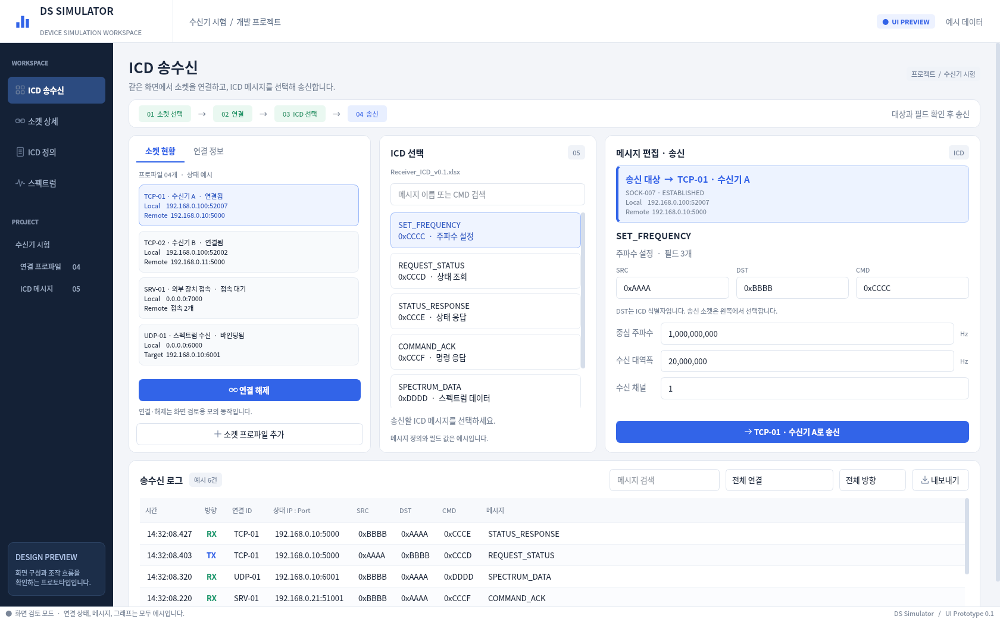

# DS Simulator

**조작 가능한 기본 프로토타입:** [prototype/README.md](prototype/README.md)

실제 TCP/UDP·HEX/UTF-8 송수신·Excel ICD 시트 가져오기·블록 편집·모의 실행·실시간 통신 모니터·전용 로그·스펙트럼 독립 창이 추가된 버전은 `prototype/`에 있습니다.
**[실행 파일 ZIP 다운로드 — 저장소에 포함](https://github.com/ekdls278/DS_GUI_SIMULATOR/raw/refs/heads/main/prototype/DS-Simulator-Windows-x64.zip)**

ZIP에는 단독 실행 가능한 `DS-Simulator.exe` 하나만 들어 있습니다. 압축을 풀고 EXE를 더블클릭하세요.

**[Windows 단일 실행 파일 다운로드 — EXE](https://github.com/ekdls278/DS_GUI_SIMULATOR/releases/download/prototype-windows-40821374560-1/DS-Simulator.exe)** · [릴리즈 상세](https://github.com/ekdls278/DS_GUI_SIMULATOR/releases/tag/prototype-windows-40821374560-1)
`DS-Simulator.exe` 파일 하나만 다운로드하여 더블클릭하세요.
소스로 실행하려면 `prototype/run-windows.cmd`를 사용하세요. 아래 내용은 기존 GUI 시안 안내입니다.

아래는 루트 `src/`에 남아 있는 **초기 GUI 시안**의 설명입니다. 최신 구현과 실행 파일은 `prototype/`을 기준으로 사용하세요.
최신 버전은 선택한 `(데이터)` 시트의 A~E열을 읽어 ICD 목록과 선택값을 구성하고 시나리오를 모의 실행합니다.
최신 버전은 실제 TCP/UDP의 원문 HEX/UTF-8 송수신을 지원합니다. ICD 자동 인코딩·계측기 제어는 아직 구현하지 않았습니다.

다른 계정이나 작업자는 먼저 [작업 인수인계 문서](HANDOFF.md)를 읽고 이어서 작업하세요.

## 화면

[**GUI 이미지 10개 한눈에 보기**](docs/GUI_PREVIEW.md)



- [ICD 메시지 화면](docs/ui-icd.png): 메시지 목록, SRC/DST/CMD 필드 정의와 헤더 표시
- [소켓 현황 화면](docs/ui-sockets.png): 앱 소켓별 상태, Local IP/Port, Remote IP/Port
- [스펙트럼 화면](docs/ui-spectrum.png): 그래프, 최대값 유지, 마커, 표시 설정
- [시나리오 화면](docs/ui-scenario.png): ICD 블록, 반복·대기, 선택 블록 속성의 정적 시안
- 통신 워크스페이스: 왼쪽 소켓 현황, ICD 선택, 메시지 입력, 송수신 로그

메뉴 전환, 예시 메시지 선택, 로그 검색·연결·방향 필터, 최대값 유지 표시 전환을
조작할 수 있습니다. 연결/해제와 송신은 메모리상의 예시 상태만 변경합니다. 가져오기·내보내기는 미구현입니다.
시나리오는 화면만 구현했으며 블록 드래그·조립과 실행 기능은 없습니다.

### 여러 통신 연결과 송신 대상

- TCP 클라이언트 2개, TCP 서버 1개, UDP 1개를 예시로 표시합니다.
- 각 연결은 고유 ID, 이름, IP와 포트로 구분합니다. 같은 이름을 써도 ID는 다릅니다.
- 왼쪽 소켓을 선택하고 연결한 다음 ICD를 선택해 송신 미리보기를 수행합니다.
- 이미 연결된 소켓은 ICD 선택 후 바로 송신 미리보기를 수행할 수 있습니다.
- 송신 영역의 강조 표시와 버튼에서 현재 선택한 연결을 확인할 수 있습니다.
- TCP 서버는 접속 클라이언트를 개별 선택합니다. 선택 전에는 송신 버튼이 비활성화됩니다.
- `연결 추가`에서 예시 연결을 계속 추가할 수 있습니다. 화면 내에서만 유지되며,
  앱을 다시 실행하면 초기 예시로 돌아갑니다. 프로파일만 등록되므로 소켓 수는 늘지 않고,
  새 프로파일은 미연결로 표시하며 송신 버튼은 비활성화합니다.

### Local / Remote와 소켓 현황

송수신 화면 왼쪽의 `소켓 현황` 탭과 별도 `소켓 상세` 메뉴에서 확인합니다.
이 화면은 **앱에서 관리하는 소켓의 예시**이며 PC 전체 소켓이나 실제 네트워크 상태를 조회하지 않습니다.
`SOCK-001` 같은 값은 UI 식별자이고 운영체제의 소켓 핸들이 아닙니다.

- `Local IP / Local Port`: 내 PC에서 사용하는 주소와 포트.
- `Remote IP / Remote Port`: 연결된 상대의 주소와 포트.
- TCP Client: 예를 들어 Local `192.168.0.100:52001` → Remote `192.168.0.10:5000`.
- TCP Server: `LISTENING` 행은 접속 대기 소켓이며 Remote가 없습니다.
  각 `Accepted` 행은 별도의 연결이며 Local `192.168.0.100:7000`을 공유해도
  Remote 주소·포트와 소켓 ID로 클라이언트를 구분합니다.
- UDP: 예시에서는 `BOUND` 상태만 표시합니다. 연결된 상대가 없으므로 Remote는 비어 있으며,
  연결 설정의 송신 대상은 별도로 표시합니다.

연결 설정의 Local IP `0.0.0.0`은 모든 로컬 인터페이스, Local Port `0`은 자동 배정 요청입니다.
설정값과 연결 후 소켓 주소를 따로 표시합니다. 실제 통신 구현 시에는 소켓에서 조회한 Local/Remote
주소를 사용해야 합니다. 현재 `192.168.0.100`과 `52001` 등의 값은 모두 시연용입니다.
서버의 Remote는 직접 설정하지 않고 접속한 클라이언트마다 확인합니다.

소켓 목록은 연결과 상태로 필터링할 수 있습니다. 행을 고르면 상세 정보만 바뀌고,
`이 소켓을 송신 대상으로 선택`을 누르면 워크스페이스의 선택에 반영됩니다.
서버 대기 소켓은 송신 대상으로 선택할 수 없습니다.

### ICD 헤더

`SRC: 0xAAAA`, `DST: 0xBBBB`, `CMD: 0xCCCC`를 주파수 설정 메시지의 예시로 표시합니다.
송신 대상을 변경하면 ICD 선택을 초기화합니다. DST는 ICD 내부 식별자이고,
송신할 TCP/UDP 연결은 별도로 선택합니다. DST를 바꿔도 연결이 자동 변경되지 않습니다.
입력값은 `0x` 접두사가 있는 16진수 표시이며, 필드 폭·배치·바이트 순서와
실제 인코딩은 아직 정하지 않았습니다. 다른 명령 코드와 페이로드도 화면 검토용 예시입니다.

## Windows 실행

Python 3.12 설치 후 저장소 폴더의 PowerShell에서 실행합니다.
가상환경 활성화 없이 아래 명령을 사용할 수 있습니다.

```powershell
py -3.12 -m venv .venv
.\.venv\Scripts\python.exe -m pip install -e .
.\.venv\Scripts\python.exe -m ds_simulator.app
```

uv가 설치되어 있다면 잠금 파일의 버전으로 실행할 수 있습니다.

```powershell
uv sync --locked
uv run ds-simulator
```

## 개발 구조

```text
src/ds_simulator/
  app.py       # 화면 구성, 송신 대상 선택과 화면 내 조작
  workspace.py # 통합 소켓/ICD 화면과 예시 상태 전환
  scenario_preview.py # 블록형 시나리오 정적 시안
  preview_data.py # 연결 설정·소켓 상태·ICD·로그 예시 (실제 네트워크 아님)
  widgets.py   # 카드, 테이블, 정적 스펙트럼 표시
  theme.py     # 색상과 Qt 스타일
docs/          # 실제 GUI에서 캡처한 화면 이미지
```

화면 검토 단계이므로 통신 엔진과 실제 ICD 모델은 아직 추가하지 않았습니다.
스펙트럼은 화면 디자인을 위한 정적 예시이며 실제 수신이나 FFT 결과가 아닙니다.

## 화면 캡처

```powershell
uv run ds-simulator --preview-stage ready --screenshot docs/ui-workspace.png
uv run ds-simulator --page sockets --screenshot docs/ui-sockets.png
uv run ds-simulator --page icd --screenshot docs/ui-icd.png
uv run ds-simulator --page spectrum --screenshot docs/ui-spectrum.png
uv run ds-simulator --page scenario --screenshot docs/ui-scenario.png
```

디스플레이가 없는 Linux에서는 `QT_QPA_PLATFORM=offscreen`을 지정합니다.
현재 검증은 Linux의 Qt offscreen 렌더링과 화면 조작 확인이며,
Windows 실기 실행·배포 검증은 아직 수행하지 않았습니다.
