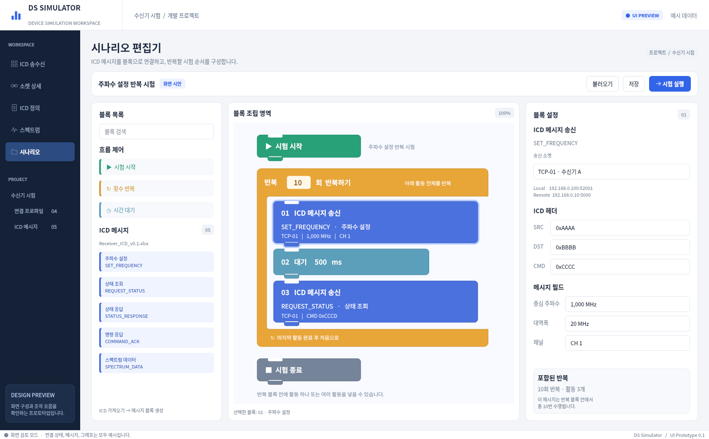
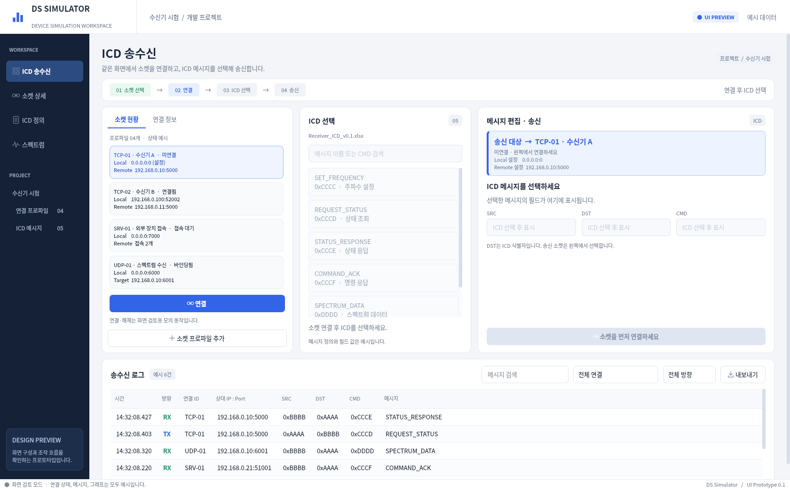
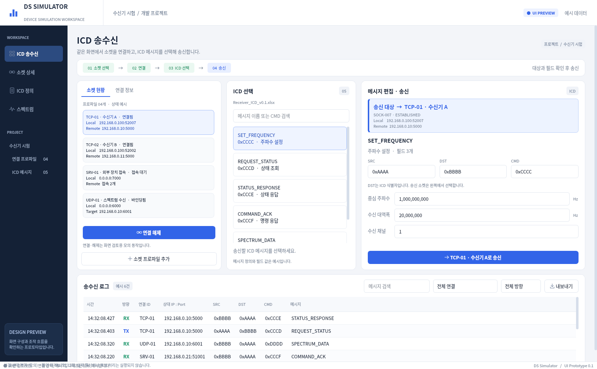
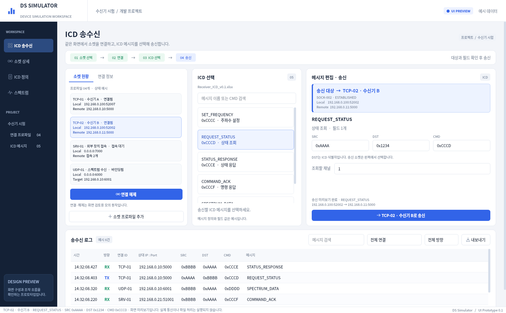
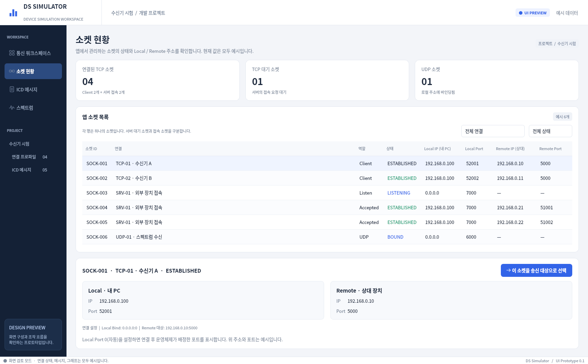
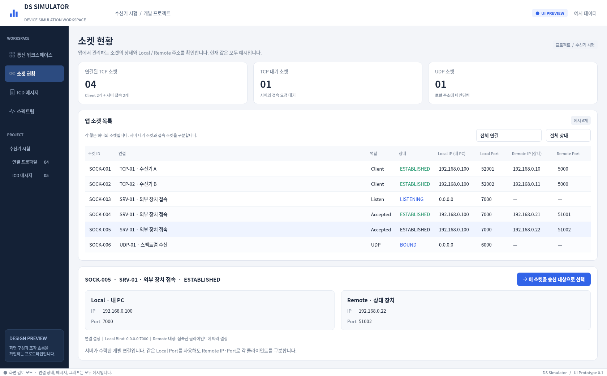
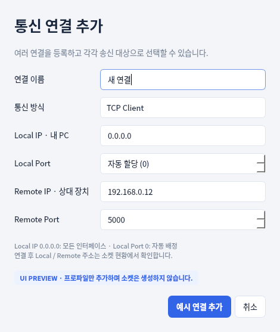
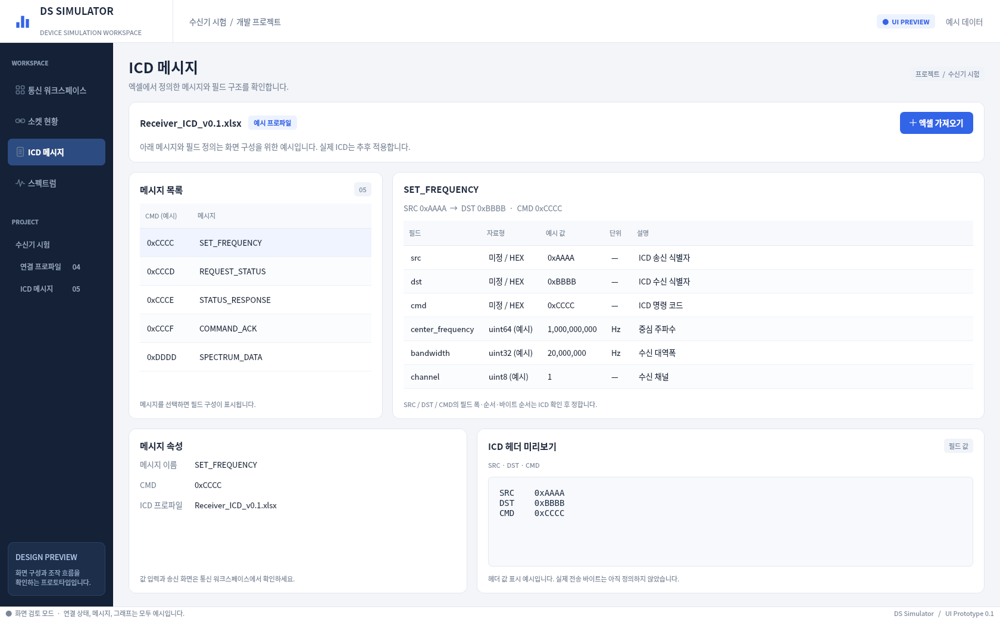
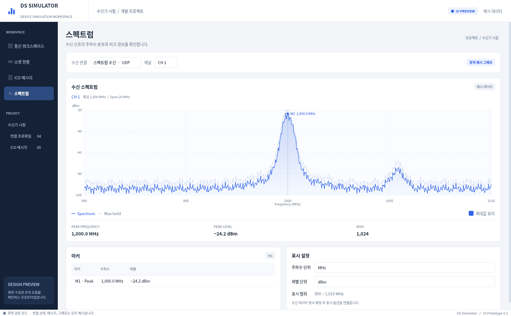

# GUI 미리보기 모음

Windows용 장비 모의 소프트웨어의 GUI 검토용 이미지입니다. 실제 통신, Excel ICD 가져오기, 데이터 저장, 장비 제어 및 시나리오 실행은 아직 구현하지 않았습니다.

먼저 **통합 송수신 화면**과 **블록형 시나리오 편집기**를 확인하세요. 나머지 이미지는 개발 과정에서 캡처한 화면으로, 최신 메뉴나 배치와 일부 차이가 있을 수 있습니다. 이미지 아래 원본 링크로 크게 볼 수 있습니다.

[프로젝트 안내](../README.md) · [작업 인수인계](../HANDOFF.md)

## 화면 바로가기

- [1. 통합 송수신 화면 — 송신 준비](#screen-1)
- [2. 블록형 시나리오 편집기](#screen-2)
- [3. 소켓 연결 전](#screen-3)
- [4. 소켓 연결 후](#screen-4)
- [5. 다른 TCP 연결 선택](#screen-5)
- [6. 소켓 상세](#screen-6)
- [7. TCP 서버 소켓 상세](#screen-7)
- [8. 연결 설정](#screen-8)
- [9. ICD 정의](#screen-9)
- [10. 스펙트럼](#screen-10)

## 1. 통합 송수신 화면 — 송신 준비

왼쪽에서 소켓을 선택하고 연결한 다음 ICD를 선택해 송신하는 화면입니다. 소켓 현황과 메시지 편집을 함께 확인합니다.

[원본 이미지 보기](ui-workspace.png)

## 2. 블록형 시나리오 편집기

왼쪽은 ICD·반복·대기 블록, 가운데는 시나리오, 오른쪽은 선택한 블록의 속성입니다. 주파수 설정 → 500ms 대기 → 상태 조회를 10회 반복하는 예시입니다. 블록 드래그·조립과 시험 실행은 아직 구현하지 않았습니다.

[원본 이미지 보기](ui-scenario.png)

## 3. 소켓 연결 전

미연결 소켓을 선택한 상태입니다. 연결 → ICD 선택 → 송신 순서로 진행합니다.

[원본 이미지 보기](ui-before-connect.png)

## 4. 소켓 연결 후

예시 연결 후 ICD 메시지를 선택한 화면입니다.

[원본 이미지 보기](ui-after-connect.png)

## 5. 다른 TCP 연결 선택

두 번째 TCP 연결을 송신 대상으로 선택한 예시입니다.

[원본 이미지 보기](ui-workspace-tcp02.png)

## 6. 소켓 상세

소켓별 상태와 Local IP/Port, Remote IP/Port를 확인하는 화면입니다.

[원본 이미지 보기](ui-sockets.png)

## 7. TCP 서버 소켓 상세

서버의 접속 대기 소켓과 접속한 클라이언트 소켓을 구분하는 화면입니다.

[원본 이미지 보기](ui-sockets-server.png)

## 8. 연결 설정

연결 이름, 통신 방식, Local/Remote 주소와 포트를 지정하는 화면입니다.

[원본 이미지 보기](ui-connection-settings.png)

## 9. ICD 정의

ICD 메시지 목록과 SRC / DST / CMD 및 예시 필드 정의를 확인하는 화면입니다.

[원본 이미지 보기](ui-icd.png)

## 10. 스펙트럼

스펙트럼 그래프와 표시 설정의 정적 예시입니다. 실제 수신 데이터나 FFT 결과는 아닙니다.

[원본 이미지 보기](ui-spectrum.png)
