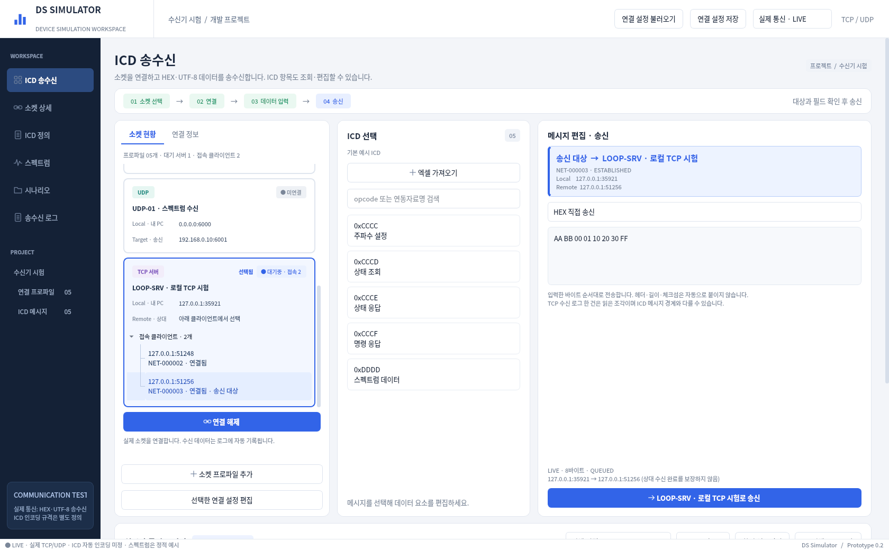
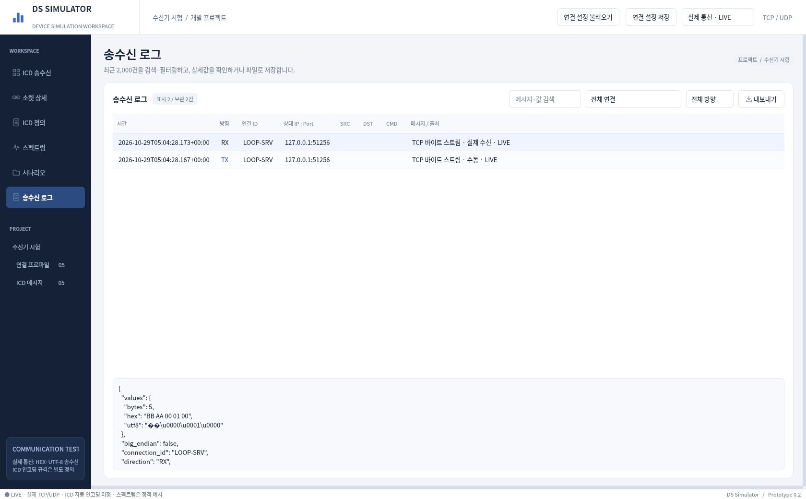
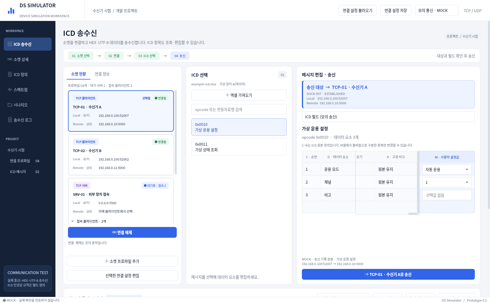
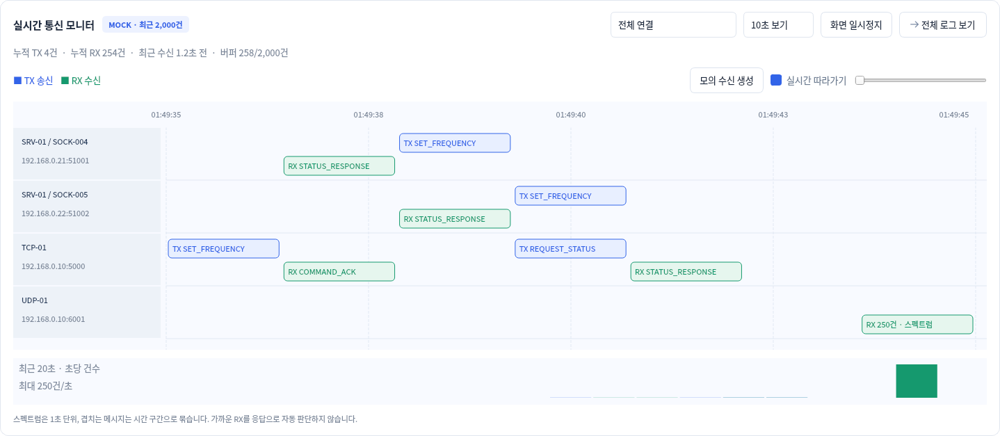
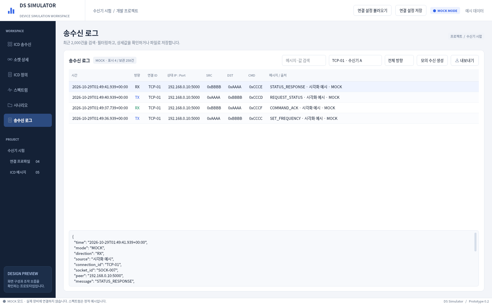
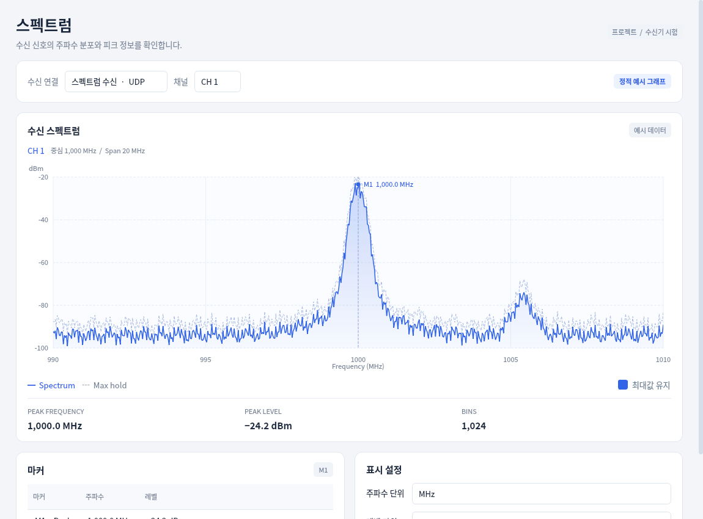
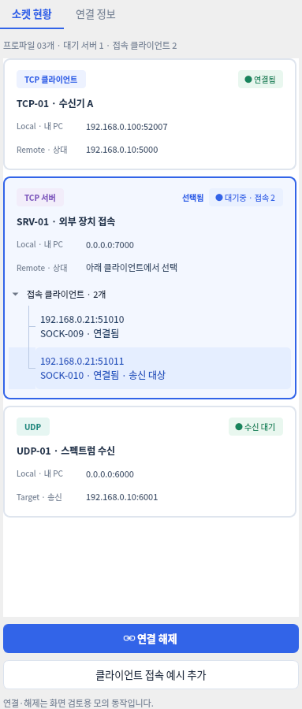

# DS Simulator

Windows용 장비 시험 소프트웨어의 **조작 가능한 데스크톱 프로토타입**입니다.
Python + PySide6로 만들었습니다. 실제 IPv4 TCP 서버·클라이언트와 UDP의 연결·송수신,
Excel ICD 조회, 시나리오 편집·실행, 파일 저장과 공통 로그를 제공합니다.
실제 통신은 **HEX/UTF-8 직접 송수신**이며, Excel의 고정 정의와 사용자 선택값을 보존하며, 장치의 바이너리 ICD 배치를 추정하지 않습니다.

**[실행 파일 ZIP 다운로드 — 저장소에 포함](https://github.com/ekdls278/DS_GUI_SIMULATOR/raw/refs/heads/main/prototype/DS-Simulator-Windows-x64.zip)**

ZIP에는 단독 실행 가능한 `DS-Simulator.exe` 하나만 들어 있습니다. 압축을 풀고 EXE를 더블클릭하세요.

**[Windows 단일 실행 파일 다운로드 — EXE](https://github.com/ekdls278/DS_GUI_SIMULATOR/releases/download/prototype-windows-40835850125-1/DS-Simulator.exe)** · [릴리즈 상세](https://github.com/ekdls278/DS_GUI_SIMULATOR/releases/tag/prototype-windows-40835850125-1)

**`DS-Simulator.exe` 파일 하나만 다운로드하여 더블클릭하세요.**
압축 해제, Python·VS Code 설치, CMD 파일, 추가 라이브러리 폴더가 필요하지 않습니다.
실행 파일 배포본은 GitHub Releases에서 관리하며 이 폴더에는 개발 소스를 보관합니다.





## Windows 실행 파일 (Python 설치 불필요)

[GitHub Releases](https://github.com/ekdls278/DS_GUI_SIMULATOR/releases)에서
`DS-Simulator.exe` 파일 하나를 받아 실행하세요. 필요한 런타임은 EXE에 내장되어 있습니다.
배포 파일은 Windows x64에서 테스트와 패키징된 프로그램의 화면 실행 검사를 통과하면 게시됩니다.
실제 통신·모의 통신의 기능과 제한은 소스 실행 버전과 같습니다. 실장비 ICD 해석과 10G 성능은 별도 검증 대상입니다.

Windows 빌드 워크플로는 [Actions](https://github.com/ekdls278/DS_GUI_SIMULATOR/actions/workflows/windows-executable.yml)에서
진행 상황을 확인하거나 `Run workflow`로 다시 실행할 수 있습니다.
빌드 커밋과 단독 실행 검사 결과는 Actions 결과물의 `validation/build-info.json`에서 확인합니다.

## Windows 소스 실행

Python 3.12를 설치하고 저장소 폴더에서 아래 명령을 실행하세요.
첫 설치에는 패키지 다운로드를 위한 인터넷 연결이 필요합니다.

```powershell
py -3.12 -m venv .venv
.\.venv\Scripts\python.exe -m pip install -e .
.\.venv\Scripts\python.exe -m ds_simulator.app
```

이후 실행은 마지막 명령만 사용합니다. `run-windows.cmd`를 더블클릭해도 됩니다.
해당 스크립트는 가상환경이 없을 때 생성하고 필요한 패키지를 설치합니다.

uv가 있다면 잠금 파일로 설치·실행할 수 있습니다.

```powershell
uv sync --locked
uv run ds-simulator
```

대화형 Windows 사용과 실제 장비 검증은 별도로 필요합니다.
Linux에서는 Python 3.12 / Qt offscreen으로 확인했고, Windows CI의 빌드별 검증 결과는
Actions 결과물의 `validation/build-info.json`에서 확인합니다.

## 실제 통신 첫 사용 순서

1. 상단에서 **실제 통신 · LIVE**를 확인합니다. 시작 시 모든 프로파일은 미연결입니다. 자동으로 장치에 접속하지 않습니다.
2. `선택한 연결 설정 편집`에서 내 Local IP·Port와 상대 Remote IP·Port를 입력하거나 `소켓 프로파일 추가`로 만듭니다. 연결 중에는 해제 후 편집합니다.
3. TCP 클라이언트는 `연결`, TCP 서버는 `서버 대기 시작`, UDP는 `연결`로 로컬 포트에 바인딩합니다.
   실제 Local/Remote 주소가 소켓 현황에 표시됩니다. TCP 접속 중에는 취소할 수 있고 10초 후 시간 초과로 종료합니다.
4. TCP 서버에는 외부 클라이언트가 실제로 접속할 때 자동으로 트리에 추가됩니다. **송신할 클라이언트 한 개를 선택**합니다. 서버당 최대 64개를 표시하며 Listen 소켓에는 송신하지 않습니다.
5. 오른쪽에서 **HEX 직접 송신**(예: `AA BB 00 01` / `0xAA 0xBB` / `AABB0001`) 또는 **UTF-8 텍스트 직접 송신**을 고릅니다.
   UTF-8은 줄 끝을 없음/LF/CRLF 중에서 선택할 수 있습니다. 문자열의 `\n`을 자동 해석하지 않고 입력한 실제 줄바꿈을 사용합니다.
6. 송신하면 실제 소켓에 바이트를 전달합니다. 헤더·길이·체크섬·엔디언 변환은 자동 적용하지 않습니다. 입력한 순서와 내용이 그대로 나갑니다.
7. 받은 데이터는 하단 통신 모니터와 `송수신 로그`에 **LIVE RX**로 자동 기록됩니다. 로그 행의 상세 맨 위에 바이트 수, HEX 원문, UTF-8 표시가 나옵니다. UTF-8로 해석되지 않는 바이트는 표시에서만 대체하며 HEX는 원문 그대로입니다.
8. `시나리오`의 **직접 송신** 블록에 HEX/UTF-8 내용과 대상을 지정하면 대기·반복과 함께 실제로 송신합니다. 저장/복원도 지원합니다(version 3). 기존 ICD 송신 블록이 포함된 실제 실행은 송신 전에 거부합니다.
9. 로그를 검색·연결·방향으로 필터링하고 JSON/CSV로 저장할 수 있습니다. 최대 최근 2,000건을 메모리에 보관하며 자동 디스크 저장은 하지 않습니다.

TCP는 바이트 스트림입니다. **로그 한 건은 읽은 조각**이며 장치의 ICD 메시지 하나와 일치한다고 볼 수 없습니다. UDP는 데이터그램별로 기록하며 실제 발신 주소·포트를 남깁니다.
TX의 `QUEUED`는 TCP 송신 버퍼 접수, `OS_ACCEPTED`는 UDP 운영체제 접수입니다. **상대 장치의 수신·응답·시험 합격을 뜻하지 않습니다.**
한 번의 직접 송신은 최대 65,536바이트, IPv4 UDP는 최대 65,507바이트입니다. TCP 송신 대기 버퍼는 소켓당 1MB를 넘으면 추가 송신을 거부합니다. 고속/10G 성능은 보장하지 않습니다.

같은 PC에서 시험하려면 한 프로파일을 `TCP Server / 127.0.0.1:7000`, 다른 프로파일을 `TCP Client / Local 127.0.0.1:0 / Remote 127.0.0.1:7000`으로 만들어 둘 다 연결하세요.
다른 PC에서는 서버 PC의 실제 IP를 Remote에 입력해야 합니다. Local에는 내 PC 주소나 `0.0.0.0`을 사용합니다. Windows 방화벽에서 서버/UDP 수신 포트가 허용돼야 외부 접속을 받을 수 있습니다.

## 기존 모의 시험

상단에서 **모의 통신 · MOCK**을 선택하거나 소스 실행 시 `--mock`을 붙입니다. 모드 전환은 모든 연결을 해제하며 로그의 LIVE/MOCK 구분은 유지합니다. 실행 중에는 모드를 바꿀 수 없습니다.
모의 모드에서는 ICD 필드 편집·송신과 `모의 수신 생성`을 사용할 수 있고 실제 소켓은 열지 않습니다.
내장 주파수 예제는 `examples/frequency-scenario.json`에서 불러올 수 있습니다. 실제 모드의 기본 시나리오는 비어 있습니다.

## Excel ICD 가져오기

`ICD 정의` 또는 `ICD 선택`의 `엑셀 가져오기`에서 `.xlsx`/`.xlsm` 파일을 선택합니다.
작은 팝업에는 이름이 `(데이터)`로 끝나는 워크시트만 나옵니다. **시트 하나를 선택하고 확인**하세요.
선택한 시트의 **2행부터 A~K·M열**을 읽습니다. L열과 N열 이후는 사용하지 않으며 다른 시트의 ICD와 기존 예시는 섞지 않습니다.

| 열 | 읽는 내용 | GUI 반영 |
|---|---|---|
| A | opcode | ICD 목록과 메시지 식별 정보 |
| B | 연동자료명 | ICD 목록과 메시지 제목 |
| C | 순번 | 표 왼쪽 고정, 원본 행 순서 유지 |
| D | 데이터 요소 | 표 왼쪽 고정, 읽기 전용 |
| E~K | 고정된 ICD 정의 | 원본 값 그대로 보존, 읽기 전용 |
| M | 사용자 설정 가능 값 | 줄바꿈으로 구분한 항목만 맨 오른쪽 드롭다운에서 선택 |

- C~K의 제목은 1행에서 읽고 비어 있으면 열별 기본 제목을 표시합니다. 값은 고정 정의이며 편집하지 않습니다.
- 표 왼쪽의 순번·데이터 요소와 오른쪽의 M 설정값은 가로 스크롤 중에도 보입니다. 가운데 E~K는 가로로 스크롤하고, 모든 열의 세로 스크롤은 같은 행을 따라갑니다.
- M열은 **줄바꿈마다 항목 하나**입니다. `저속 운용`과 `고속 운용`이 서로 다른 줄이면 두 항목입니다. 항목 안의 띄어쓰기·탭은 유지합니다. 빈 줄은 제외하고 동일 항목은 한 번 표시합니다.
- M열이 한 줄의 `OFF ON AUTO`이면 하나의 선택값입니다. 띄어쓰기로 나누지 않습니다.
- M 선택값이 있으면 첫 항목을 초기 선택값으로 사용합니다. M이 비면 `선택값 없음`으로 표시하고 직접 입력하지 못하게 합니다. C~K 정의는 그대로 남습니다.
- A·B열이 반복되거나 같은 메시지의 아래 행에서 빈칸/병합 셀로 이어지는 경우를 처리합니다. 같은 opcode·연동자료명의 행은 한 메시지로 묶고 중복된 데이터 요소 이름도 별도 항목으로 유지합니다.
- ICD 목록에는 **opcode와 연동자료명만** 표시합니다. 연결 전에도 선택하여 표를 조회·편집할 수 있습니다.
- `ICD 정의`에서는 C~K와 M의 선택 가능 항목을 읽기 전용으로 조회합니다. 시나리오의 `데이터 요소 표에서 편집`은 넓은 창에서 같은 표와 M 드롭다운을 사용합니다.
- C~K 원본 정의와 M 선택값은 시나리오 저장/복원 및 모의 송수신 로그에서도 구분해 보존합니다. 로그의 `data_elements[].fixed`는 C~K, `value`는 M 선택값입니다.
- 원본 Excel은 읽기만 하며 수정·복사·업로드하지 않습니다. A~K·M의 수식은 Excel이 마지막으로 계산해 저장한 결과를 읽습니다. 수식 실행이나 외부 참조 갱신은 하지 않습니다.
- 계산 결과가 없으면 셀 위치를 안내합니다. Excel에서 **전체 재계산(Ctrl+Alt+F9) → 저장 → 다시 가져오기**를 하세요. 오류 값(`#REF!`, `#DIV/0!` 등)도 먼저 수정해야 합니다. 최신 값이 필요하면 Excel에서 재계산·저장하세요.
- `.xls`는 `.xlsx`로 저장해 사용하세요. 실제 데이터 타입·선택값의 숫자 의미·패킷 바이트 배치는 추정하지 않습니다.

새 ICD를 확인하면 목록과 시나리오 팔레트가 선택한 시트의 메시지로 교체되고, 시나리오는 새 시험으로 초기화됩니다.
저장하지 않은 시나리오는 저장/취소할 수 있습니다. 시트 선택 취소나 읽기 오류가 나면 기존 내용을 유지합니다.
시나리오에는 고정 정의·열 제목·선택값과 현재 선택을 포함해 원본 Excel 없이 다시 열 수 있습니다(중첩 ICD catalog version 2).
기존 E열 방식의 catalog version 1 저장본도 읽지만, 화면에 `이전 E열 형식`이라고 표시합니다. **새 C~K/M 규칙을 적용하려면 Excel을 다시 가져오세요.** 기존 저장본을 M열 형식으로 추정 변환하지 않습니다.
시나리오 파일에는 ICD 내용이 포함되므로 사용자 자료에 맞는 위치에 저장하세요. 파일은 최대 2MB입니다.

`examples/example-icd.xlsx`는 검증용 **가상 데이터**이며 실제 회사 ICD가 아닙니다. Excel 설치 없이 읽을 수 있습니다.
실제 통신은 HEX/UTF-8 직접 송수신입니다. 헤더 20바이트의 배치와 데이터 필드 길이·타입·엔디언·프레이밍·체크섬 규격이 확정되면 자동 ICD 인코딩/수신 해석을 연결할 수 있습니다.




## 스펙트럼 독립 창과 통신 모니터

- 왼쪽 `스펙트럼` 메뉴는 메인 화면을 바꾸지 않고 별도의 창을 엽니다. 메인 화면과 함께 조작할 수 있습니다.
- 이미 열린 창은 앞으로 가져오며, 닫았다가 다시 열어도 같은 창과 표시 설정을 유지합니다.
- 왼쪽 `송수신 로그` 메뉴에는 검색·연결·방향 필터, 상세값, JSON/CSV 내보내기를 배치했습니다.
- 기존 하단 로그 자리에는 연결별 TX/RX 타임라인을 배치했습니다. TCP 서버는 Accepted 소켓별로 다른 줄에 표시합니다.
- 메시지 구간을 클릭하면 실제 기록된 값을 확인합니다. 묶음 상세는 최근 100건까지 보여 주고 전체 보관 기록은 로그 화면에서 확인합니다.
- 5·10·30·60초 보기, 실시간 따라가기, 기준 시점에서 최대 120초 이전으로 이동할 수 있습니다.
- `화면 일시정지`는 표시할 데이터만 고정합니다. 수집, 수동 송신, 시나리오와 전용 로그 갱신은 계속됩니다.
- 스펙트럼 메시지는 1초 단위로 묶고, 서로 겹치는 일반 메시지도 시간 구간으로 묶습니다. 요청·응답 관계를 자동 추정하지 않습니다.
- 누적 TX/RX와 최근 수신 시각, 최근 20초의 초당 건수를 표시합니다. 누적/건수 집계는 최근 2,000건의 개별 표시 버퍼와 별개입니다.

스펙트럼 자체는 기존의 **정적 예시**이며 실제 FFT·장비 수신값이 아닙니다.
모니터와 로그는 각 기록의 LIVE/MOCK을 구분합니다. 실제 모드에서는 수신 생성 버튼을 숨기고 실제 소켓의 수신만 기록합니다. 일시정지는 기록 파일의 자동 저장을 의미하지 않습니다.







## 소켓별 역할·상태·선택 표시

ICD 송수신 화면의 모든 소켓은 동일한 카드 형식을 사용합니다.
역할, 연결 상태, 현재 선택은 서로 다른 요소로 표시합니다.

| 표시 | 의미 |
|---|---|
| 역할 배지 | 파란 TCP 클라이언트, 보라 TCP 서버, 청록 UDP |
| 상태 배지 | 연결됨, 대기중·접속 수, 수신 대기, 미연결·중지됨 |
| 파란 테두리·배경과 선택됨 표시 | 사용자가 현재 선택한 연결 |
| 클라이언트 행의 송신 대상 표시 | 송신에 사용할 Accepted 소켓 |

카드마다 연결 ID·이름과 Local 주소를 같은 위치에 표시합니다.
TCP 클라이언트는 Remote 주소, UDP는 송신 Target 주소를 표시합니다.
TCP 서버는 하위 클라이언트를 접고 펼칠 수 있는 트리로 묶습니다.
서버가 여러 개여도 같은 형식의 카드에서 ID·이름·Local 주소와 하위 목록으로 구분합니다.

- 클라이언트 행을 클릭하면 해당 서버의 정확한 Accepted 소켓을 선택합니다.
- 대상을 바꾸면 ICD 선택이 초기화됩니다. 메시지를 다시 확인하고 송신하세요.
- 서버 상단을 누르면 하위 클라이언트 선택이 해제됩니다. Listen 소켓에는 송신하지 않습니다.
- 서버를 중지하면 하위 클라이언트 목록과 송신 대상이 함께 해제됩니다.
- `0.0.0.0`은 내 PC의 모든 인터페이스를 뜻합니다. 실제 NIC 주소 하나를 의미하지 않습니다.
- 별도 소켓 상세 메뉴의 수치 표는 유지합니다.



## 연결과 설정 저장

- TCP Client, TCP Server, UDP의 실제 연결과 별도 모의 모드를 지원합니다. 새 프로파일은 `소켓 프로파일 추가`로 만듭니다.
- 상단 `연결 설정 저장/불러오기`는 **프로파일만** 저장합니다. 불러오면 기존 실제/모의 연결은 해제됩니다.
- 시나리오 JSON에는 블록과 대상 연결 ID를 저장합니다. 연결 프로파일은 별도 파일입니다.
- 시나리오를 다른 PC에서 쓰려면 연결 설정도 함께 불러오고 실제/모의 모드를 확인한 뒤 다시 연결하세요.
- TCP 서버는 Listen 소켓으로 송신할 수 없습니다. 실제 클라이언트의 접속 후 Accepted 소켓을 선택합니다. 모의 모드에서는 접속 예시 버튼을 사용합니다.
- 서버 시나리오 블록에도 Accepted 소켓을 명시적으로 선택해야 합니다.
  소켓 ID는 실행 중 식별자이므로 저장 파일을 다시 사용할 때 서버 대상을 재선택하세요.
- 실행 시작 시 대상 소켓을 고정합니다. 실행 중 끊기거나 재연결되면 다른 소켓으로 대체하지 않고 오류로 중지합니다.
- `DST`는 ICD 내부 식별자입니다. IP 목적지나 선택 연결을 자동 변경하지 않습니다.
- Local `0.0.0.0`과 Port `0`은 바인드 설정입니다. 실제 모드에서 연결 후 주소는 소켓에서 조회합니다.

`examples/frequency-scenario.json`과 `examples/connections.json`에 기본 예제가 있습니다.
파일을 읽는 과정에서 오류가 발생하면 기존 편집 내용과 연결 설정을 유지합니다.
시나리오를 변경한 상태에서 새 시험·불러오기·종료를 선택하면 저장 여부를 묻습니다.

## 현재 범위와 제한

| 기능 | 상태 |
|---|---|
| 기존 송수신·소켓 상세·ICD 정의 화면 | 유지 |
| 수동 필드 편집·검사·공통 모의 송신 | 구현 |
| 시나리오 추가·이동·반복 중첩·삭제·설정 | 구현, Qt 기본 위젯 사용 |
| 실제 직접 송신/모의 실행·중지·진행 표시·편집 잠금 | 구현 |
| 시나리오·연결 설정 JSON 저장/불러오기 | 구현 |
| 공통 로그·상세값·검색·필터·JSON/CSV 저장 | 구현, 최근 최대 2,000건 유지 |
| Excel ICD 가져오기 | C~K 고정·M 줄바꿈 선택값, 2행부터, (데이터) 시트 한 개 |
| 과제 폴더 탐색·범용 ICD 변환 | 미구현 |
| 실제 TCP 서버·클라이언트 / UDP | IPv4, 비동기 연결·수신·해제, 원문 HEX/UTF-8 송신 |
| ICD 자동 인코딩·디코딩·체크섬 | 미구현, wire 규격 필요 |
| 응답 대기·자동 합격/불합격 판정 | 미구현 |
| 계측기 제어·FFT·복조·10G 부하 검증 | 미구현 |
| 스펙트럼 | 독립 창, 그래프는 기존 정적 예시 |
| 통신 모니터 | 연결별 타임라인·묶음 상세·화면 일시정지·시간 탐색·초당 건수 |

빅엔디안은 설정과 로그에만 기록하며 바이트 변환은 수행하지 않습니다.
기본 예시의 입력 검사는 uint/float32 자료형 기준이며 장치별 물리적 허용 범위를 의미하지 않습니다. 가져온 Excel은 C~K를 고정하고 M열의 줄바꿈 구분 문자열 선택값만 변경합니다.
시나리오는 블록 1,000개, 반복 중첩 8단계, 펼친 활동 10,000개까지 지원합니다.
빈 반복은 편집·저장은 가능하지만 실행 시 활동을 추가해야 합니다.

## 개발 구조

```text
src/ds_simulator/
  app.py              # 창, 메뉴, ICD 정의, 소켓 상세, 실행 CLI
  workspace.py        # 소켓 선택과 수동 송신 화면
  connection_cards.py # 서버별 박스와 Accepted 클라이언트 트리
  scenario_editor.py  # 블록 편집 UI, 속성, 저장/불러오기
  domain.py           # Qt와 독립된 블록/시나리오, 검사, JSON 저장
  icd.py              # 로컬 Excel C~K 고정/M 선택값 파서와 ICD 모델
  icd_ui.py           # 데이터 시트 선택, ICD 정의 화면
  icd_widgets.py      # C/D·M 고정 표와 수동/시나리오 공통 선택값 입력
  runtime.py          # LIVE/MOCK 라우터, 취소 가능한 QTimer 실행기
  network.py          # QtNetwork 실제 TCP/UDP, 바인드·접속·수신·해제
  wire.py             # HEX/UTF-8 직접 송신 검사 (ICD 규격 추정 없음)
  network_check.py    # frozen EXE의 실제 루프백 패키징 검증
  profiles.py         # 연결 설정 파일 검사와 저장/복원
  activity.py         # 전용 로그 화면, 배치 갱신, 상세값·필터·내보내기
  traffic.py          # Qt 독립 집계, bounded 버퍼와 누적/초당 건수
  traffic_monitor.py  # 타임라인, 구간 상세, 일시정지, 시간 탐색
  preview_data.py     # 예시 연결·소켓·ICD 정의
  widgets.py/theme.py # 공통 UI와 정적 스펙트럼
```

시나리오는 임의의 Python 코드가 아닌 버전이 있는 JSON입니다.
수동·시나리오 송신은 같은 LIVE/MOCK 전송 계층을 사용합니다.
실제 소켓은 QtNetwork의 비동기 시그널로 처리하며 UI 스레드에서 블로킹 connect/recv를 하지 않습니다.
직접 송신 블록이 있는 시나리오는 version 3이며 기존 version 1/2를 계속 읽습니다.
Blockly / QtWebEngine은 아직 도입하지 않았습니다.

## 검증과 화면 캡처

```powershell
uv run python -m unittest discover -s tests -v
uv run ds-simulator --page scenario --screenshot scenario.png
uv run ds-simulator --mock --preview-stage ready --screenshot workspace.png
uv run ds-simulator --page logs --screenshot logs.png
uv run ds-simulator --page spectrum --screenshot spectrum-popup.png
```

디스플레이 없는 Linux에서는 `QT_QPA_PLATFORM=offscreen`을 설정합니다.
83개 테스트로 C~K 원본 보존·M 줄바꿈/공백·빈 M 입력 차단·표의 고정 열/스크롤·이전 카탈로그 호환과 실제 루프백 TCP/UDP 양방향 바이트, 다중 접속 대상·해제·재연결·포트 충돌·연결 거부·모드 전환·원문 로그·직접 송신 시나리오와 수식의 저장된 결과·계산 결과 누락·Excel 오류 값, 모델·파일 검사, 중첩 반복 순서, 중지, 연결 해제 오류,
수동·시나리오 공통 로그, GUI 편집·저장 복원·필터 내보내기를 확인했습니다.
드래그의 마우스 조작과 Windows 네이티브 파일 대화상자는 별도 수동 확인 대상입니다.
기존 정적 시안은 [이전 GUI 이미지 모음](docs/GUI_PREVIEW.md)에 남아 있습니다.

## 실행 파일을 직접 빌드하기

Windows x64의 Python 3.12 환경에서 `prototype` 폴더를 작업 폴더로 사용합니다.

```powershell
py -3.12 -m venv .venv
.\.venv\Scripts\python.exe -m pip install -e . -r packaging/requirements-build.txt
.\.venv\Scripts\python.exe -m unittest discover -s tests -v
.\.venv\Scripts\python.exe packaging/build_windows.py
```

결과는 `dist/DS-Simulator.exe` 단일 파일이며 SHA-256 파일도 함께 생성됩니다.
빌드 스크립트는 EXE 하나만 새 임시 폴더에 복사해 송수신·시나리오·전용 로그·스펙트럼 독립 창 및 가상 Excel ICD 가져오기의 PNG 생성과 실제 TCP 서버/클라이언트·UDP 루프백 바이트 왕복·소켓 해제를 검사합니다. `validation/network-check.json`에 결과를 남깁니다.
Linux에서 이 스크립트를 실행하면 Windows 빌드가 필요하다는 안내와 함께 중단합니다.
