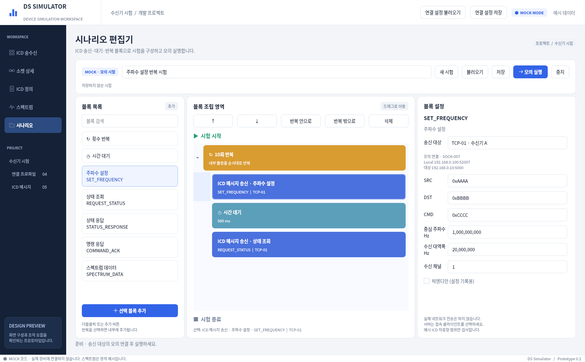
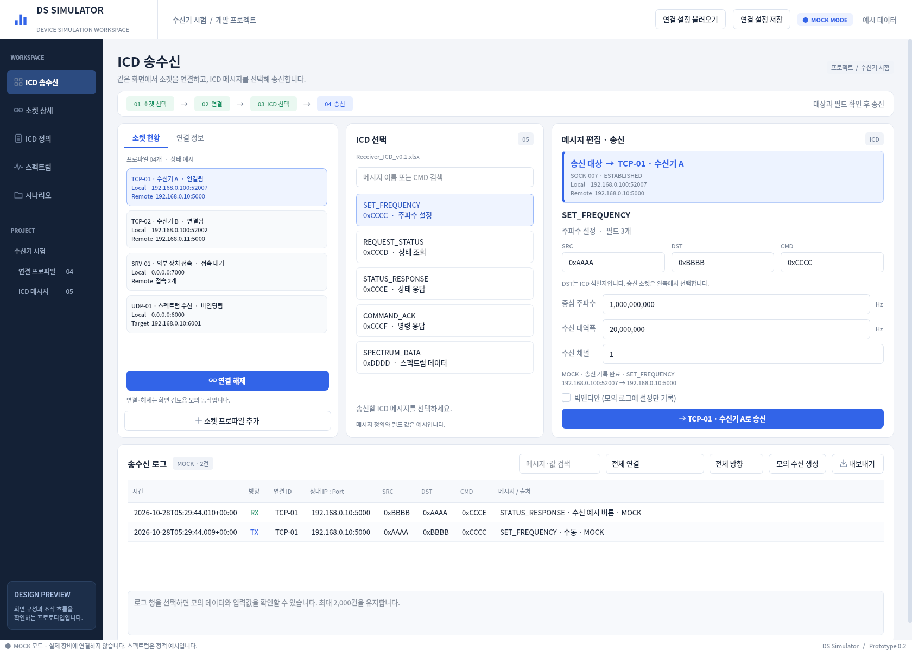

# DS Simulator

Windows용 장비 시험 소프트웨어의 **조작 가능한 데스크톱 프로토타입**입니다.
Python + PySide6로 만들었습니다. 기존 GUI 시안을 이어서 시나리오 편집, 모의 실행,
파일 저장과 공통 로그를 구현했습니다. 실제 네트워크 소켓을 열거나 장비를 제어하지 않습니다.





## Windows 실행

Python 3.12를 설치하고 저장소 폴더에서 아래 명령을 실행하세요.
첫 설치에는 패키지 다운로드를 위한 인터넷 연결이 필요합니다.

```powershell
py -3.12 -m venv .venv
.\.venv\Scripts\python.exe -m pip install -e .
.\.venv\Scripts\python.exe -m ds_simulator.app
```

이후 실행은 마지막 명령만 사용합니다. `run-windows.cmd`를 더블클릭해도 됩니다.
해당 스크립트는 가상환경이 없을 때 생성하고 필요한 패키지를 설치합니다.

uv가 있다면 잠금 파일로 설치·실행할 수 있습니다.

```powershell
uv sync --locked
uv run ds-simulator
```

Windows 실제 장비·배포 검증은 아직 수행하지 않았습니다.
현재 검증 환경은 Linux / Python 3.12 / Qt offscreen입니다.

## 첫 사용 순서

1. `ICD 송수신`에서 `TCP-01 · 수신기 A`를 선택하고 `연결`을 누릅니다.
   연결·주소·소켓 ID는 모의 데이터입니다.
2. `SET_FREQUENCY`를 선택하고 중심 주파수, 대역폭, 채널을 편집합니다.
   SRC/DST/CMD의 HEX 형식과 예시 자료형 범위를 검사합니다.
3. 송신 버튼을 누르면 아래 로그에 **MOCK TX**와 실제 입력값이 기록됩니다.
   로그 행을 선택하면 필드값, 대상 소켓, 출처, 엔디언 설정을 확인할 수 있습니다.
4. `모의 수신 생성`은 선택 연결의 예시 상태 응답을 **MOCK RX**로 기록합니다.
   송신 시 장치 응답이나 시험 성공을 자동 생성하지 않습니다.
5. `시나리오`로 이동합니다. 기본 예제는 **주파수 설정 → 500ms 대기 → 상태 조회를 10회 반복**합니다.
6. 블록을 선택해 오른쪽에서 반복 횟수, 대기시간, 연결 대상, 헤더와 필드값을 수정합니다.
7. 왼쪽 블록을 더블클릭하거나 `선택 블록 추가`를 누릅니다.
   반복을 선택했다면 내부에, 다른 활동을 선택했다면 그 뒤에 추가됩니다.
8. 드래그 또는 위·아래 / 반복 안으로·밖으로 버튼으로 순서를 바꿉니다.
   내부에 넣을 때는 앞에 반복 블록이 있어야 합니다. 삭제는 선택 블록과 그 내부 활동에 적용됩니다.
9. `모의 실행`을 누릅니다. 현재 활동을 강조하고 진행 횟수를 표시합니다.
   이 예제는 30개 활동, 20건의 모의 송신을 수행합니다. `중지`는 대기 중에도 작동합니다.
10. `저장`으로 시나리오를 JSON에 저장하고 `불러오기`로 복원할 수 있습니다.
    로그는 송수신 화면에서 검색·연결·방향으로 필터링한 결과를 JSON/CSV로 내보냅니다.

## 연결과 설정 저장

- TCP Client, TCP Server, UDP의 모의 연결을 지원합니다. 새 프로파일은 `소켓 프로파일 추가`로 만듭니다.
- 상단 `연결 설정 저장/불러오기`는 **프로파일만** 저장합니다. 불러오면 기존 모의 연결은 해제됩니다.
- 시나리오 JSON에는 블록과 대상 연결 ID를 저장합니다. 연결 프로파일은 별도 파일입니다.
- 시나리오를 다른 PC에서 쓰려면 연결 설정도 함께 불러오고 모의 연결을 다시 하세요.
- TCP 서버는 Listen 소켓으로 송신할 수 없습니다. 접속 예시를 추가하고 Accepted 소켓을 선택합니다.
- 서버 시나리오 블록에도 Accepted 소켓을 명시적으로 선택해야 합니다.
  소켓 ID는 실행 중 식별자이므로 저장 파일을 다시 사용할 때 서버 대상을 재선택하세요.
- 실행 시작 시 대상 소켓을 고정합니다. 실행 중 끊기거나 재연결되면 다른 소켓으로 대체하지 않고 오류로 중지합니다.
- `DST`는 ICD 내부 식별자입니다. IP 목적지나 선택 연결을 자동 변경하지 않습니다.
- Local `0.0.0.0`과 Port `0`은 바인드 설정입니다. 표시되는 연결 후 주소는 시연용입니다.

`examples/frequency-scenario.json`과 `examples/connections.json`에 기본 예제가 있습니다.
파일을 읽는 과정에서 오류가 발생하면 기존 편집 내용과 연결 설정을 유지합니다.
시나리오를 변경한 상태에서 새 시험·불러오기·종료를 선택하면 저장 여부를 묻습니다.

## 현재 범위와 제한

| 기능 | 상태 |
|---|---|
| 기존 송수신·소켓 상세·ICD 정의 화면 | 유지 |
| 수동 필드 편집·검사·공통 모의 송신 | 구현 |
| 시나리오 추가·이동·반복 중첩·삭제·설정 | 구현, Qt 기본 위젯 사용 |
| 모의 실행·중지·진행 표시·실행 중 편집 잠금 | 구현 |
| 시나리오·연결 설정 JSON 저장/불러오기 | 구현 |
| 공통 로그·상세값·검색·필터·JSON/CSV 저장 | 구현, 최근 최대 2,000건 유지 |
| Excel ICD 가져오기·과제 폴더 탐색 | 미구현, 실제 Excel/JSON 규격 필요 |
| 실제 TCP/UDP·패킷 인코딩·체크섬 | 미구현, wire 규격 필요 |
| 응답 대기·자동 합격/불합격 판정 | 미구현 |
| 계측기 제어·FFT·복조·10G 부하 검증 | 미구현 |
| 스펙트럼 | 기존 정적 예시, 실제 수신값 아님 |

빅엔디안은 설정과 로그에만 기록하며 바이트 변환은 수행하지 않습니다.
입력 검사는 예시 uint/float32 자료형 기준이며 장치별 물리적 허용 범위를 의미하지 않습니다.
시나리오는 블록 1,000개, 반복 중첩 8단계, 펼친 활동 10,000개까지 지원합니다.
빈 반복은 편집·저장은 가능하지만 실행 시 활동을 추가해야 합니다.

## 개발 구조

```text
src/ds_simulator/
  app.py              # 창, 메뉴, ICD 정의, 소켓 상세, 실행 CLI
  workspace.py        # 소켓 선택과 수동 송신 화면
  scenario_editor.py  # 블록 편집 UI, 속성, 저장/불러오기
  domain.py           # Qt와 독립된 블록/시나리오, 검사, JSON 저장
  runtime.py          # 공통 MockTransport, 취소 가능한 QTimer 실행기
  profiles.py         # 연결 설정 파일 검사와 저장/복원
  activity.py         # 공통 모의 로그, 상세값, 필터, 내보내기
  preview_data.py     # 예시 연결·소켓·ICD 정의
  widgets.py/theme.py # 공통 UI와 정적 스펙트럼
```

시나리오는 임의의 Python 코드가 아닌 버전이 있는 JSON입니다.
수동·시나리오 송신은 같은 메시지 검사와 MockTransport를 사용합니다.
실제 통신 구현 시 전송 계층을 추가하고 UI에서 작업을 분리하는 구조로 확장합니다.
Blockly / QtWebEngine은 아직 도입하지 않았습니다.

## 검증과 화면 캡처

```powershell
uv run python -m unittest discover -s tests -v
uv run ds-simulator --page scenario --screenshot scenario.png
uv run ds-simulator --preview-stage ready --screenshot workspace.png
```

디스플레이 없는 Linux에서는 `QT_QPA_PLATFORM=offscreen`을 설정합니다.
22개 테스트로 모델·파일 검사, 중첩 반복 순서, 중지, 연결 해제 오류,
수동·시나리오 공통 로그, GUI 편집·저장 복원·필터 내보내기를 확인했습니다.
드래그의 마우스 조작과 Windows 네이티브 파일 대화상자는 별도 수동 확인 대상입니다.
기존 정적 시안은 [이전 GUI 이미지 모음](docs/GUI_PREVIEW.md)에 남아 있습니다.
